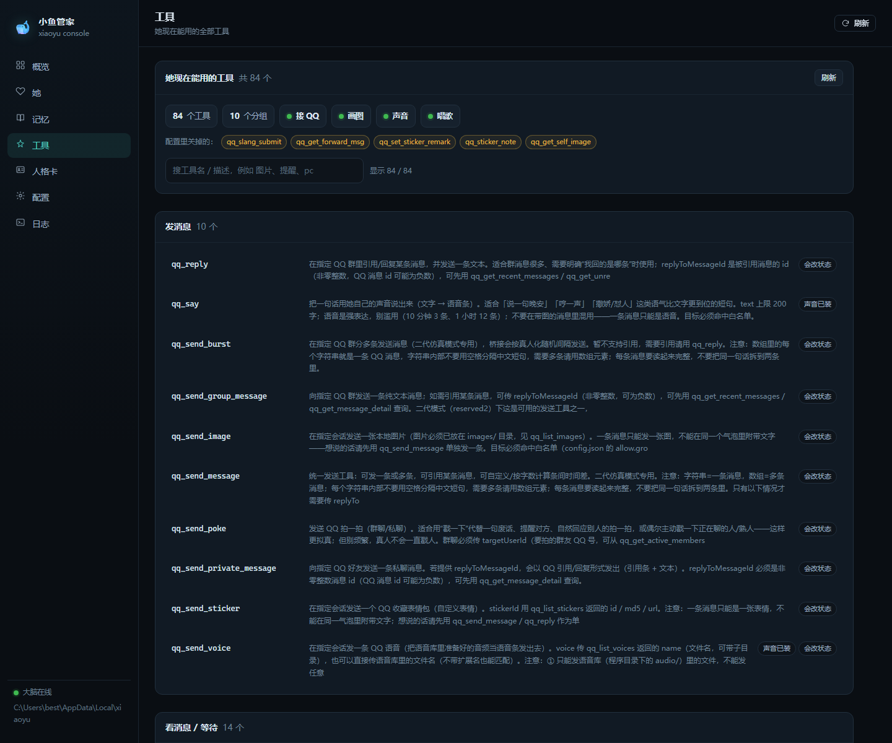
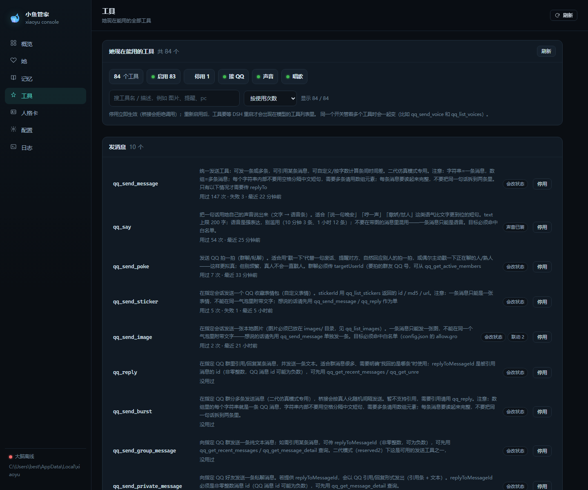

# 小鱼

[](https://github.com/czfdth/xiaoyu/releases)
[](https://github.com/czfdth/xiaoyu/releases)
[](LICENSE)
[](#)
[](https://github.com/czfdth/xiaoyu/actions/workflows/ci.yml)

一个跑在自己电脑上的 AI 陪伴机器人：接 QQ，有声音、会画画、会唱歌、会写日记。

这是源码仓库。私人配置、记忆、图片、音频、备份和依赖目录不随 Git 上传；发行包可另行包含运行依赖与授权素材。代码不依赖某个旧仓库的绝对路径。

## 截图

工具页（每个工具的启用状态与用量）：



工具用量与停用：



## 备份与恢复密钥

- 每天 04:50 本机备份；05:05 加密出站到 OneDrive；05:35 自动恢复演练；05:45 刷新恢复包。
- 恢复包默认在 `Documents\xiaoyu-recovery`：`backup-key.txt`（明文密钥 + 指纹）和 `RECOVERY.md`（恢复步骤）。
- 密钥文件是明文，**存进密码管理器或离线 U 盘后请删除本文件**；密钥和 `.enc` 备份不要放在同一块盘。
- 解密：`node scripts/decrypt-backup.mjs <备份.zip.enc> <输出.zip>`，再 `bin/restore.ps1 -From <输出.zip> -Force`。

## 从源码运行与测试

需要 Node.js ≥22.13。先安装根目录及管家后端依赖：

```powershell
npm ci
npm --prefix gui ci
node src/paths.js --init
npm run test:life
```

`test:life` 覆盖记忆归属、承诺证据、事件分层、画册分步执行、上下文预算，以及真实 bridge/MCP 接本地假 QQ 的集成测试。
测试不需要真实 QQ 登录或模型 API key，也不会向真实 QQ 发消息。

那条真实 bridge/MCP 集成测试（`tests/agency-integration.test.mjs`）要 spawn 两次 bridge 再连 MCP，
在 GitHub Actions 的共享 runner 上会挂死（本地 ≤3 秒），所以 CI 里按环境跳过；想跑它：

```powershell
npm run test:integration      # = XIAOYU_IT=1 node --test tests/agency-integration.test.mjs
```

绘图、语音和 QQ 的真实运行仍需安装、配置对应外部服务。通过自动化测试不等于绘图服务可用，也不证明模型会稳定执行或正确评价作品。

本轮功能说明：

- [记忆归属、约定履约与主动调度](docs/记忆与约定修复.md)
- [实际事件、自述与想象分层](docs/事件来源分层.md)
- [经历、反思与实际行为调整](docs/经验学习闭环.md)
- [发送、语音、草图、页面与约定的执行调整](docs/工具执行调整.md)
- [纠正、验收、练习、自我认识与误会修复](docs/连续相处五项能力.md)
- [绘图失败后的换路](docs/drawing-recovery.md)
- [画册的选题、草稿、修改、归档与交付](docs/画册分步执行.md)

旧数据保留；来源不明的旧个人资料暂停自动事实注入。画册原有进度不追溯认证，新页面的归档与交付分别核验。升级既有安装时，先备份并只同步程序文件，不要覆盖运行目录的 `state/`、`roles/`、`images/`、`audio/` 或 `config.json`。

---

## 新用户：一键部署

双击 **`一键部署.bat`**（或 `powershell -ExecutionPolicy Bypass -File bin\deploy.ps1`），它会：

1. 检查 Node（≥22），把程序装到 `%LOCALAPPDATA%\xiaoyu`
2. 找 SnowLuma（已装就问你要不要打开，**登录要你自己扫码**）
3. **找 DSH（大脑）**：自动发现它这次启动的随机端口，写进 `dsh.baseUrl`；没注册过就把 MCP / preset 注册进去
4. 等网关上线 → 自动发现 token / 端口，写进 `config.json`（不用手抄）
5. 生成 **6 位配对码**，起大脑和管家面板
6. 你用**自己的 QQ** 私聊她，把这 6 位发过去 → 自动认主

> 前置：本机要装有 **DeepSeek Harness（DSH）** 并已登录模型——她的大脑是它。
> 没装也不影响部署，面板会明确显示「大脑没连上」并告诉你去装。

配对码的边界：只在**还没有主人**时有效、只认私聊、15 分钟过期、错 5 次作废、成功即删。

手动也行：

```powershell
# 1) 初始化（建 state/logs，生成 config.json，并探测本机的引擎在哪）
node src/paths.js --init

# 2) 打开 config.json，填这四项
#    ownerQQ              你自己的 QQ 号
#    allow.private        允许私聊她的 QQ 号
#    allow.groups         允许她进的群号
#    snowluma.accessToken SnowLuma 的 token（也可以让 first-run 自动发现）

# 3) 自检（不连 QQ、不连 DSH，只看配置和目录对不对）
node src/bridge.js --check

# 4) 起全部（Windows）
powershell -ExecutionPolicy Bypass -File bin\start-all.ps1
```

**只装不用配**（复制到 `%LOCALAPPDATA%\xiaoyu`、建开始菜单、开机自启）：

```powershell
powershell -ExecutionPolicy Bypass -File install.ps1
```

---

## 管家（全栈控制台）

浏览器打开 **http://127.0.0.1:8765**（或双击 `打开管家.bat`，或 `bin\xiaoyu.ps1 gui`）：

```powershell
node gui/server.mjs          # 用本目录的数据
bin\xiaoyu.ps1 gui           # 没起就起，然后开浏览器
```

**接到现有数据上跑**（迁移期：代码用这份，数据仍指向老目录，不动老仓库）：

```powershell
$env:XIAOYU_HOME = 'C:\path\to\老的数据目录'   # config/state/roles/images/audio 都从这里读
node gui/server.mjs
```

代码（`src/ scripts/ dsh/ plugins/ public/ gui/`）永远跟着文件走，
数据（`config.json / state/ / roles/ / images/ / audio/`）跟着 `XIAOYU_HOME` 走 ——
所以可以「新面板 + 老数据」并行跑，确认没问题再迁。

| 页面 | 能干什么 |
|---|---|
| **概览** | 五个端口、四项能力、引擎路径、她此刻在干嘛、一键启停 |
| **她** | 内部状态、身体四项、心情、按天翻聊天记录 |
| **一生** | 出生、第几天、阶段与解锁（初识→熟悉→默契→家人→老伴）、她的一天、作品集、年鉴、完整时间线 |
| **记忆** | 日记 / 回忆录 / 梦 / 幻想，左边列表右边读（Markdown 渲染） |
| **工具** | 她现在能用的全部工具（84 个）按用途分组，显示每个工具用过几次/失败几次/最近一次，可单独停用或启用 |
| **花费** | token 花在哪：按天/按会话的 prompt、缓存命中率、估算花费；以及两道上下文刹车（单回合步数上限、超限后换会话） |
| **人格卡** | 直接编辑 `roles/*.md`，保存即热生效，自动留备份 |
| **配置** | 主人 QQ、白名单、DSH、SnowLuma token（只显示有没有）、引擎路径 |
| **日志** | bridge / activity 日志，自动刷新、复制 |
| **首次设置** | 四步向导：主人 → 网关 → 引擎 → 完成 |

技术栈（都在 GitHub 上活跃维护，npm 安装）：

```
前端  Vue 3.5 + Vue Router 4 + Vite 8      gui/web/    → 构建到 gui/dist/
后端  Fastify 5 + @fastify/static          gui/server/ → REST /api/*
```

**开发模式**（改前端热更新）：

```powershell
cd gui
npm install         # 安装包里只带了运行时依赖，构建工具要先装回来
npm run dev:api     # 后端 :8765
npm run dev:web     # 前端 :5173，/api 代理到 8765
```

**改完前端要重新构建**（安装包里带的是构建产物）：

```powershell
cd gui && npm run build
```

安全边界：只监听 `127.0.0.1`；写操作要求同源 + `application/json`；密钥只回「有没有」，不回内容；
动作只允许 `start / stop / restart` 三个白名单脚本；改配置和人格卡前自动备份。

---

## 路径只有一个来源

所有「从哪来」的判断都在 **`src/paths.js`**，别的地方不再拼 `..`、也不认盘符：

```
src/paths.js
  ├─ 包根 / state / logs / roles / images / audio / scripts / dsh / plugins
  ├─ 端口表（3000 网关 / 3001 WS / 9880 声音 / 8188 画图 / 3100 大脑 / 8765 管家）
  ├─ 引擎探测（SnowLuma / GPT-SoVITS / ComfyUI / RVC / ffmpeg）
  └─ 首次运行：生成 config.json（含探测到的引擎路径）
```

启动脚本、状态面板、GUI 全部读同一份：

```powershell
node src/paths.js            # 人看的摘要
node src/paths.js --json     # 给脚本解析（bin\start-all.ps1 就是这么拿路径的）
node src/paths.js --init     # 建目录 + 生成 config.json（幂等）
node src/paths.js --check    # 自检，缺东西退出码 1
```

可覆盖（可选）：

| 环境变量 | 作用 |
|---|---|
| `XIAOYU_HOME` | 数据根换地方（接老数据 / 便携版） |
| `XIAOYU_DATA` | 只把 state/logs 放别处 |
| `XIAOYU_AI_VOICE` | ai-voice 目录（唱歌/参考音频） |
| `SNOWLUMA_HOME` / `GPT_SOVITS_HOME` / `COMFYUI_HOME` | 直接指定引擎目录 |

探测结果也会写进 `config.json` 的 `engines` 段，手改那里同样生效（优先级：环境变量 > config > 常见安装位置 > 包内 `engines/`）。

---

## 连接层（SnowLuma）

和 SnowLuma 有关的一切都收在 **`src/snowluma/`**，业务代码里不再出现
`fetch('.../send_msg')`、Bearer 头、retcode 判断或自己拼 `httpUrl`：

```
src/snowluma/
  http.js      createOneBotHttp()     一条 HTTP 连接：request（信封）/ call（data）
  discover.js  token / 端点自发现（换 QQ 账号后自动跟上，HTTP 和 WS 是两套 token）
  link.js      createSnowLumaLink()   WS + HTTP 组合，形状对齐 @snowluma/sdk
  index.js     唯一入口（含 text / image / record / at / reply 等消息段）
```

用它的三处：

| 谁 | 用什么 | 为什么 |
|---|---|---|
| `src/bridge.js` | `createSnowLumaLink()` | 收消息走 WS、发消息/兜底走 HTTP、自愈回写 token |
| `src/mcp-*.js` | `createOneBotHttp()` | 81 个 QQ 工具只调 action；401 时自动重新发现 token |
| `gui/server/data.mjs` | `createOneBotHttp()` | 概览里显示网关当前登录的号（`小鱼 · 你的号`） |

```powershell
npm run test:link                                    # 离线：假 OneBot 服务，11 项契约
$env:XIAOYU_SNOWLUMA_LIVE=1; npm run test:link       # 额外连一次真网关（只读，不发消息）
```

细节和契约见 [src/snowluma/README.md](src/snowluma/README.md)。

---

## 省 token（上下文预算）

一条 DSH 会话的历史**只增不减**，而每一步都要把整段历史重新发一次。实测一支群聊会话从 2.1 万 token
长到 77 万 token 后，单步就要重发 77 万 —— 钱几乎全花在「重复发送同一段旧历史」，不是花在说话上。

桥接里有两个刹车，都能在控制台 **花费** 页调（`config.json` 里是 `socialV2.context`）：

| 键 | 默认 | 作用 |
|---|---|---|
| `maxStepsPerTurn` | `30` | 单回合跑到这么多步还没收尾就直接打断（正常聊天 1~6 步结束，几十步基本是在同一个工具上打转） |
| `rotatePromptTokens` | `80000` | 单步 prompt 超过它，这一轮结束就换一条新 DSH 会话，并把最近几条消息带过去接力 |
| `rotateMinTurns` | `20` | 会话至少跑过这么多回合才允许轮换（太短轮换只白付一次冷启动） |

填 `0` 关闭对应那一项；改完重启桥接生效。

- 轮换不会丢人设/唤醒配置/记忆（那些在 `config.json` 和 `state/` 里，跟会话无关），只换 DSH 那条历史
- 轮换后第一次唤醒会走完整引导，并附一段「【接着上次】最近聊到这些」，所以不会突然失忆
- 真实效果看 **花费** 页的「按会话 · 最近一步」：标黄说明这条会话正贴着轮换线

另外：预算只在**回合之间**生效。回合进行中换会话会把回复截断，所以轮换判定统一放在回合收尾之后。

---

## 运维

- **看门狗**：`bin\xiaoyu.ps1 watchdog`（开机自启默认带）——bridge / 面板掉了自动拉起
- **迁移**：`bin\migrate.ps1 -From <旧 qq-bridge> -DryRun` → 去掉 `-DryRun` 真迁（自动备份 + 回滚说明）
- 细节见 [docs/运维.md](docs/运维.md)

---

## 目录

```
src/paths.js           唯一路径来源（第一个该看的文件）
src/snowluma/          SnowLuma 连接层：HTTP / WS / token 自发现 / 消息段
src/bridge.js          QQ ↔ DSH 桥接主程序
src/mcp-*.js           三个 MCP server（QQ 工具 / 网关状态 / 联网）
bin/start-all.ps1      一键启动（读 paths.js，不写死路径）
bin/status.mjs         状态面板（--json 可给 GUI）
bin/xiaoyu.ps1         命令行管家（status/start/stop/restart/log/me/paths）
gui/server.mjs         本地网页面板 http://127.0.0.1:8765
roles/                 人格卡
images/                表情包/图库
audio/                 语音库
state/                 她的记忆、日记、梦（**升级不碰这里**）
logs/                  运行日志
config.example.json    配置模板（首次运行据此生成 config.json）
scripts/               安装/维护脚本（setup-dsh、手绘渲染、ASR…）
```

---

## 引擎（都可以不装）

| 能力 | 引擎 | 没有会怎样 |
|---|---|---|
| 聊天 | DSH（任意 LLM） | 核心，必须有 |
| 接 QQ | SnowLuma（自己装，程序只探测不部署） | 没 QQ |
| 声音 | GPT-SoVITS | 只发文字 |
| 画图 | ComfyUI + SD1.5 | 画不了图 |
| 唱歌 | RVC + `sing_pipeline.py` | 唱不了 |
| GIF | ffmpeg | 不做动图 |

`bin\start-all.ps1` 会按顺序拉起**探测到且没在跑**的那些，没装的跳过并说清楚原因。

---

## 常用命令

```powershell
node bin/status.mjs                 # 状态
node bin/status.mjs --json          # 状态（机器读）
bin\xiaoyu.ps1 gui                  # 开管家面板（没起就起）
bin\xiaoyu.ps1 watchdog             # 看门狗：大脑/面板掉了自动拉
bin\gateway.ps1                     # QQ 网关状态（SnowLuma，不随包分发）
bin\tasks.ps1 -List                 # 她的定时行为（21 条）状态
bin\backup.ps1                      # 备份她的记忆（zip，保留 14 天）
bin\migrate.ps1 -From <旧目录> -DryRun   # 从旧 qq-bridge 迁数据（先看计划）
bin\xiaoyu.ps1 start -WithGui       # 起全部 + 面板
node gui/server.mjs                 # 只起面板
node src/bridge.js                  # 只起大脑
node src/bridge.js --check          # 冒烟检查
npm run test:link                   # 连接层契约（离线假 OneBot）
npm run test:pairing                # 配对逻辑（纯函数）
npm run test:pairing-e2e            # 配对端到端（假 OneBot，起真 bridge）
npm run dsh                         # 找 DSH 端口 + 注册 MCP/preset
node scripts/setup-dsh.mjs          # 把 MCP / preset / 插件注册进 DSH
```

---

## 升级与卸载

- 升级：直接再跑 `install.ps1`，程序文件整体覆盖，`state/` 与 `config.json` 保留。
- 卸载：`powershell -File "$env:LOCALAPPDATA\xiaoyu\uninstall.ps1"`；加 `-Purge` 连记忆一起删。

---

MIT。人格卡模板仅供参考，你写的那个属于你。
**请别用它冒充真人、骚扰他人或生成违法内容。**
